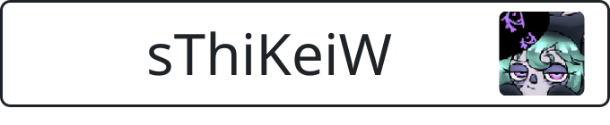
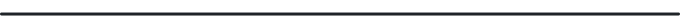
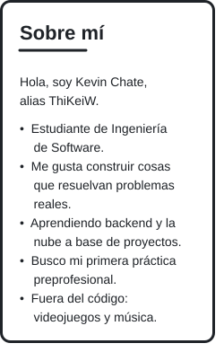
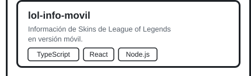
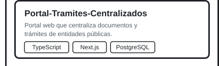
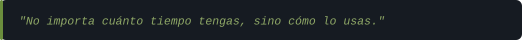
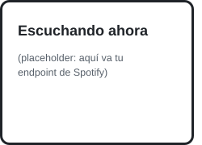
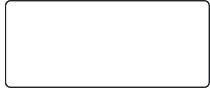

<!-- ============================================================
     BLOQUE 1: ENCABEZADO (nickname + avatar, todo dentro de header.svg)
     ============================================================ -->

<!-- ============================================================
     BLOQUE 2: CONTACTO (etiqueta + íconos en una sola línea)
     ============================================================ -->

<!-- WhatsApp -->
&nbsp;&nbsp;&nbsp;
<!-- LinkedIn -->
&nbsp;&nbsp;&nbsp;
<!-- Gmail -->
&nbsp;&nbsp;&nbsp;
<!-- Discord (opcional): descomenta y pon tu enlace

-->

<!-- Línea divisoria -->

<!-- ============================================================
     CUERPO: bloques con esquinas redondeadas (SVG), sin tablas.
     Todos usan align="left" y se acomodan en dos columnas:
       columna izquierda = 250 px | columna derecha = 430 px
     El orden de abajo importa. No lo cambies.
     ============================================================ -->

<!-- BLOQUE 3: SOBRE MÍ (columna izquierda, arriba) -->

<!-- BLOQUE 4: PROYECTOS DESTACADOS (columna derecha, arriba)
     Marco armado en 4 piezas apiladas: título, proyecto 1, proyecto 2, cierre.
     Cada proyecto es clicable. Para cambiar texto/stack: edita assets/proyecto-N.svg -->

<!-- FRASE (columna derecha, bajo proyectos; color en assets/frase.svg) -->

<!-- BLOQUE 5: SPOTIFY (columna izquierda, abajo)
     Cuando despliegues tu endpoint, cambia el src por: https://TU-APP.vercel.app/api/spotify
     El endpoint debe devolver un SVG de 250 px de ancho con esquinas redondeadas. -->

<!-- BLOQUE 6: CUADRO RESERVADO (columna derecha, abajo)
     Sin definir aún. Ideas: stack general, "aprendiendo ahora", más proyectos. -->

