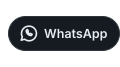
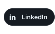

<!-- ============================================================
     Diseño en bloques: SVG propios (assets/) + tarjetas de github-stats-extended.
     Todo va dentro de un solo 
. Columna izquierda = align="left",
     columna derecha = align="right". El ORDEN de las etiquetas importa.
     Los anchos están en % para que el diseño escale con la pantalla.
     ============================================================ -->

<!-- BLOQUE 1: ENCABEZADO (HOLA, SOY / sThiKeiW. + avatar embebido) -->

<!-- BLOQUE 2: CONECTA CONMIGO (etiqueta a la izquierda, botones a la derecha)
     Los botones se declaran de derecha a izquierda: WhatsApp, Correo, LinkedIn -->

<!-- Línea divisoria (también corta el flotado de la fila de contacto) -->

<!-- BLOQUE 3: SOBRE MÍ (izquierda, arriba) -->

<!-- BLOQUE 4: PROYECTOS DESTACADOS (derecha) -->

<!-- BLOQUE 5: LENGUAJES MÁS USADOS (izquierda, abajo) — github-stats-extended -->

<!-- FRASE (derecha, bajo los proyectos). Color: editar fill en assets/frase.svg -->

